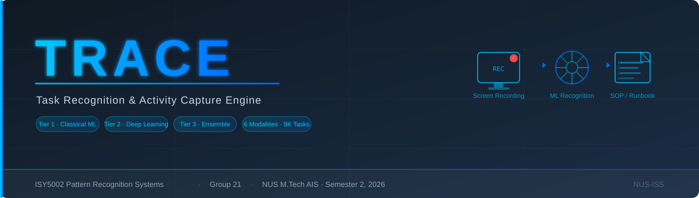

<div align="center">
  
</div>

# TRACE — Task Recognition & Activity Capture Engine

**A Multi-Tier Ensemble Approach for Multimodal Activity Recognition and Automated SOP Generation from Desktop Screen Recordings**

NUS M.Tech AIS — ISY5002 Pattern Recognition Systems | Group 21 | Semester 2, 2026

* * *

## Executive Summary

Desktop screen recordings contain expert knowledge that is impossible to search or reuse. **TRACE** automatically converts these recordings into structured SOPs and runbooks by fusing six modalities — visual frames, OCR text, UI context, command/log signals, interaction events, and temporal patterns — through a three-tier classifier.

| Metric | Value |
|--------|-------|
| Dataset | 277 tasks · 8 apps · ~2.3 GB (VideoCUA subset) |
| Activity classes | 17 (coding, debugging, media editing, diagram design, …) |
| Best model (v3) | Stacking ensemble — F1 **0.89** |
| vs. v2 baseline | +76% macro-F1 improvement (KNN 0.51 → Stacking 0.89) |
| Feature vector | 1,391 dims (OCR + UI + CNN-visual + interaction) |
| Models trained | 6 — SVM, KNN, Random Forest (Tier 1) · LSTM, CNN1D (Tier 2) · Stacking (Tier 3) |

**System components:**

- **Ingestion** — video upload, frame extraction, action log parsing
- **Feature extraction** — EfficientNet-B0 CNN visual features, EasyOCR, YOLO UI detection, interaction statistics
- **Multi-tier classifier** — classical ML → deep learning → ensemble fusion
- **Knowledge generation** — LLM-powered SOP, runbook, and timeline generation
- **Dashboard** — React frontend for upload, activity timeline, and knowledge retrieval

* * *

## Project Contribution

| Member | Student ID | Scope | Email |
|--------|-----------|-------|-------|
| Lakshmi Barthwal Chamoli | A0340664E | AWS infrastructure, video upload, OCR pipeline, SVM, Naive Bayes, temporal sequence analysis, CI/CD | *(email)* |
| Yuan Zilin | A0283899Y | React dashboard, workflow visualization, ground-truth collection, evaluation framework, MLP, CNN1D, Voting ensemble | *(email)* |
| Stalin Sagayaraj | A0340115X | Docker, video ingestion, YOLO UI detection, LSTM, Transformer | *(email)* |
| Muthaiah Muneeswaran | A0019650J | FastAPI backend, multi-tier classifier, Decision Tree, Random Forest, multimodal late fusion, CI/CD, monitoring | *(email)* |

* * *

## Video Demo

| Video | Link |
|-------|------|
| Promotional overview | *(link to be added)* |
| Technical walkthrough | *(link to be added)* |

* * *

## User Guide

The full setup and run guide is in [SourceCode/backend/README.md](SourceCode/backend/README.md).

**Quick start (Docker):**

```bash
# Clone
git clone https://github.com/laxmi1707/PatternRecognSystem-Video2Text.git
cd PatternRecognSystem-Video2Text

# Start backend + frontend + DB
docker compose up -d

# Access
# Frontend:  http://localhost:5173
# API docs:  http://localhost:8000/docs
```

**Demo credentials:**

```
Username: demo
Password: demo1234
```

* * *

## Research Questions

| RQ | Question | Experiment |
|----|----------|------------|
| RQ1 | Classical ML vs. deep learning for multimodal activity recognition? | Tier 1 vs. Tier 2 |
| RQ2 | Does multimodal fusion beat individual modalities? | Tier 3 ensemble + modality ablation |
| RQ3 | Can sequence models identify higher-level workflows from activity sequences? | LSTM/Transformer on activity sequences |

* * *

## Architecture

```
Screen Recording
      │
      ▼
┌─────────────────────────────────────────────┐
│            Feature Extraction               │
│  OCR(50) · UI/YOLO(30) · CNN-Visual(1280)  │
│  Interaction(30) · Temporal(1) = 1,391 dim  │
└────────────────────┬────────────────────────┘
                     │
      ┌──────────────┼──────────────┐
      ▼              ▼              ▼
  Tier 1          Tier 2         Tier 3
Classical ML    Deep Learning   Ensemble
SVM · KNN      LSTM · CNN1D   Stacking ← best
Random Forest               (SVM+RF+MLP base)
      │              │              │
      └──────────────┴──────────────┘
                     │
                     ▼
           Activity Label (17 classes)
                     │
                     ▼
         LLM Knowledge Generation
      SOP · Runbook · Timeline · RAG
```

| Layer | Technologies |
|-------|-------------|
| Frontend | React 18, TypeScript, Vite |
| Backend | Python 3.11, FastAPI, SQLAlchemy (async) |
| ML | PyTorch, scikit-learn, XGBoost, LightGBM, EfficientNet-B0 |
| OCR / Vision | EasyOCR, YOLO, OpenCV, Albumentations |
| Database | PostgreSQL + pgvector |
| LLM | Anthropic Claude (SOP/runbook generation) |
| Cloud | AWS ECS Fargate, S3, SageMaker |
| CI/CD | GitHub Actions, Docker, MLflow |

* * *

## Project Report

Full report: [ProjectReport/](ProjectReport/) *(final PDF to be linked after Oct 31)*

* * *

## Key Dates

| Date | Milestone |
|------|-----------|
| Sep 15, 2026 | Project proposal submitted |
| Sep 30, 2026 | First presentation (Zoom, 6:30–10:30 pm) |
| Oct 31, 2026 | Final deliverables — code, report, demo video |

* * *

## Miscellaneous

Screenshots and assets: [Miscellaneous/images/](Miscellaneous/images/)

---

*NUS-ISS M.Tech in Artificial Intelligence Systems — ISY5002 Pattern Recognition Systems*
